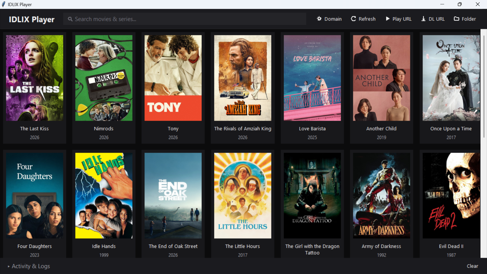
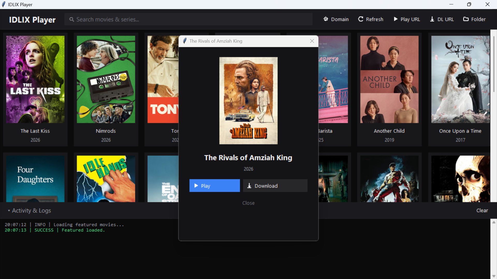
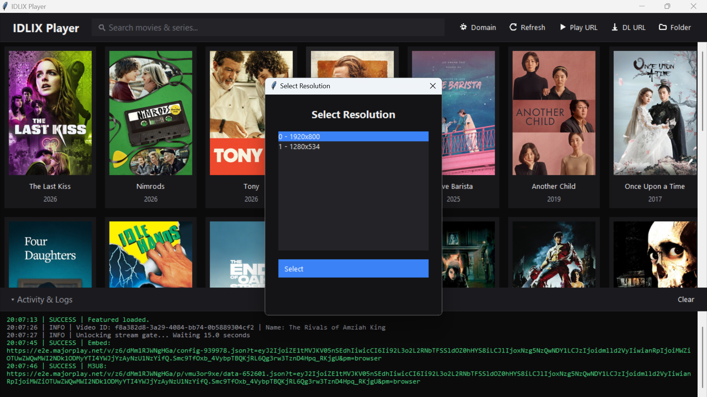
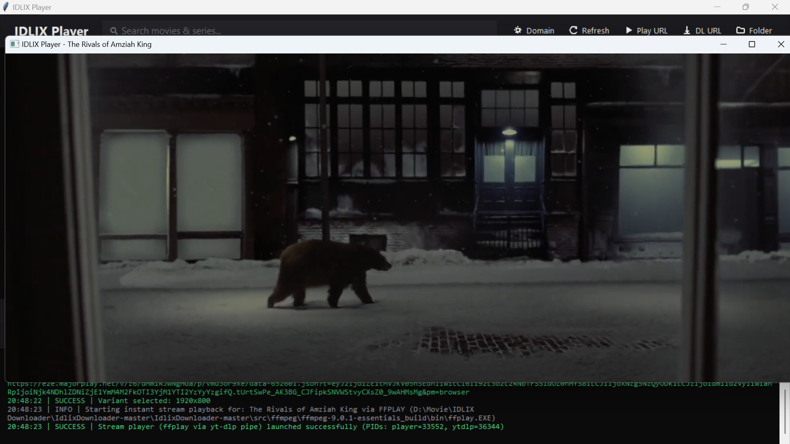

# 🎬 IDLIX Downloader & Player (Overhauled & Redesigned)


A modern, cinematic desktop application for browsing, streaming, and downloading movies & TV series from IDLIX with dynamic domain recovery, encrypted M3U8 key decryption support, dual-level poster caching, real-time logging, and responsive poster layouts.

> 📢 **Note & Credits**: Project ini merupakan versi *Overhaul & Redesign* dari repository original [sandrocods/IdlixDownloader](https://github.com/sandrocods/IdlixDownloader). Versi ini telah dimodifikasi secara masif pada bagian backend scraper, arsitektur konfigurasi domain dinamis, alur enkripsi token, pengunduhan `yt-dlp`, serta perombakan total pada sisi UI/UX.

---

## 📸 Tangkapan Layar (Screenshots)

| Tampilan Utama Grid Poster | Detail & Quick Action Modal |
| :---: | :---: |
|  |  |

| Pemilihan Season & Episode | Domain Configuration & Recovery |
| :---: | :---: |
|  |  |

---

## 🚀 Fitur Unggulan (Key Features)

### 🎨 1. Modern Cinematic Dark Theme & Responsive UI
- **Pure Tkinter & Canvas Vector Icons**: Didesain tanpa ketergantungan `CustomTkinter`, menggunakan ikon vektor berbasis Canvas yang crisp (*Search*, *Play*, *Download*, *Settings*, *Logs*, *Refresh*, *Folder*).
- **Responsive Card Reflow (Debounced)**: Grid poster film & TV series secara otomatis menyesuaikan jumlah kolom (2 hingga 6+ kolom) secara dinamis mengikuti lebar window pengguna tanpa stuttering atau terpotong.
- **Movie & Series Modal**: Dialog modal overlay saat poster diklik, menampilkan detail film/series, poster resolusi tinggi, navigasi Season & Episode (untuk TV Series), serta tombol cepat *Play*, *Download*, dan *Open Web Page*.
- **Collapsible Activity Logs**: Panel log terintegrasi di bagian bawah dengan *level syntax highlighting* (`INFO`, `SUCCESS`, `WARNING`, `ERROR`) yang dapat ditutup/dibuka dengan 1 klik (maksimal 500 baris untuk efisiensi memori).
- **Now Playing & Download Status Bar**: Progress bar real-time, persentase pengunduhan, serta kontrol Pause, Resume, dan Cancel di bagian footer.

### 🌐 2. Dynamic Domain Configuration & Domain Recovery System
- **Centralized Domain Config (`config.json`)**: Domain utama tersimpan secara terpusat dan dapat diperbarui secara dinamis tanpa perlu mengubah kode program.
- **Dynamic Request Headers**: Menghapus header hardcoded `Host` dan menghasilkan header `Referer` serta `Origin` secara dinamis sesuai domain yang aktif.
- **Non-blocking Startup Health Check**: Aplikasi mengecek status kesehatan domain secara otomatis di background saat startup tanpa membekukan antarmuka GUI.
- **Domain Recovery Dialog**: Modal dialog interaktif yang muncul jika domain mengalami error/timeout. Pengguna dapat memilih *Retry Current Domain*, *Test New Domain*, atau memperbarui domain aktif secara langsung.

### ⚡ 3. Dual-Level Poster Caching System (Performance Boost)
- **In-Memory LRU Cache**: Menampung hingga 60 thumbnail poster di RAM dengan strategi *Least Recently Used* (LRU) untuk rendering grid super cepat.
- **Disk Cache Persisten**: Gambar asli/terkompresi disimpan di `.cache/posters/` menggunakan MD5 hashing URL untuk mencegah pengunduhan HTTP berulang.

### 📥 4. Integrated `yt-dlp` Downloader Engine
- **M3U8 AES Key Decryption Fix**: Mengganti downloader lama yang gagal mendekripsi kunci HLS dengan `yt-dlp` via `subprocess`.
- **Query Authorization Token Preservation**: Otomatis mempertahankan token keamanan (`?t=...`) dan header pendukung (`Referer`, `User-Agent`, `Origin`) sehingga terhindar dari error `401 Unauthorized` atau `DOWNLOAD KEY FAILED`.
- **Full Download Control**: Mendukung fitur Pause, Resume, dan Cancel yang otomatis membersihkan file parsial (`.part`, `.ytdl`, `.temp`) agar direktori tetap bersih.
- **Real-Time Log Streaming**: Persentase unduhan dan log detail dipipa secara real-time langsung ke UI.

---

## 🛠️ Prasyarat (Requirements)

- **Python**: 3.8 atau lebih baru.
- **FFmpeg**: Diperlukan untuk pemutaran video via `ffplay` atau VLC. (Di Windows, program dapat secara otomatis mengunduh dan mengonfigurasi FFmpeg jika belum terinstal).
- **yt-dlp**: Diperlukan untuk pengunduhan video terenkripsi M3U8.

---

## 📦 Cara Instalasi & Penggunaan

### 1. Clone Repository
```bash
git clone https://github.com/USERNAME_KAMU/IdlixDownloader-Overhauled.git
cd IdlixDownloader-Overhauled
```

### 2. Instal Dependensi Python
```bash
pip install -r requirements.txt
```

### 3. Jalankan Aplikasi

#### 🖥️ Mode GUI (Disarankan):
```bash
python main_gui.py
```

#### 💻 Mode CLI (Command Line):
```bash
python main.py
```

---

## 🛠️ Struktur Project

```
IdlixDownloader/
├── main_gui.py          # Antarmuka Desktop Modern (Pure Tkinter + Canvas Vector)
├── main.py              # Versi Command-Line Interface (CLI)
├── config.json          # Konfigurasi Domain Terpusat (Dynamic Base URL)
├── requirements.txt     # Daftar dependensi Python
├── readme.md            # Dokumentasi project
├── screenshot/          # Tangkapan Layar Tampilan Antarmuka Aplikasi
├── Unduhan Film/Series/ # Folder Otomatis Output Hasil Unduhan (Video MP4 & Subtitle SRT)
└── src/
    ├── idlixHelper.py   # Scraper REST API, Domain Recovery, Poster Cache, & Downloader Engine
    ├── CryptoJsAesHelper.py # Helper dekripsi AES
    └── ffmpeg/          # Folder otomatis untuk binary FFmpeg (Windows)
```

---

## 📝 Perbandingan Perubahan (Changelog / Improvements)

| Fitur / Komponen | Repositori Asli | Versi Overhauled Ini |
| :--- | :--- | :--- |
| **Domain IDLIX** | Hardcoded domain lama (Rusak) | **Dynamic Domain Manager & Recovery System** (`config.json` + Health Check Dialog) |
| **Header Handling** | Static Host/Referer hardcoded | **Dynamic Headers** (`Referer` & `Origin` mengikuti domain aktif) |
| **Downloader Engine** | `m3u8_To_MP4` (Error key 401) | Integrated `yt-dlp` + Token Preservation + Pause/Resume/Cancel & File Cleanup |
| **Performansi Poster** | Download HTTP berulang tanpa cache | **Dual-Level Poster Cache** (In-Memory LRU 60 items + Persistent Disk Cache) |
| **Grid UI** | Grid kaku terpotong & scroll rusak | **Responsive Grid** (Debounced auto-column math 2–6+ cols) |
| **Tampilan / UI** | Desain dasar dengan emoji | **Cinematic Dark Theme** dengan Pure Tkinter & Vector Canvas Icons |
| **Series & Movies** | Terbatas pada Movie sederhana | Full Support **Movie & TV Series** dengan Navigasi Season/Episode |
| **Stream Player** | Direct ffplay HLS load (Mismatch Error) | **Real-Time Stream Piping** (`yt-dlp -o -` piped to `ffplay -i -` / VLC) |
| **Status Bar & Log** | Log statis tanpa filter | **Collapsible Log Drawer** dengan Level Syntax Highlighting (Max 500 lines) |

---

## 📄 Lisensi & Disclaimer

- **Credits**: Terima kasih kepada [sandrocods](https://github.com/sandrocods) atas ide awal dan repositori original [IdlixDownloader](https://github.com/sandrocods/IdlixDownloader).
- **Disclaimer**: Proyek ini dikembangkan hanya untuk tujuan edukasi, riset arsitektur GUI Python, dan pembelajaran teknik parsing stream HLS. Segala risiko penggunaan di luar tanggung jawab pengembang.
